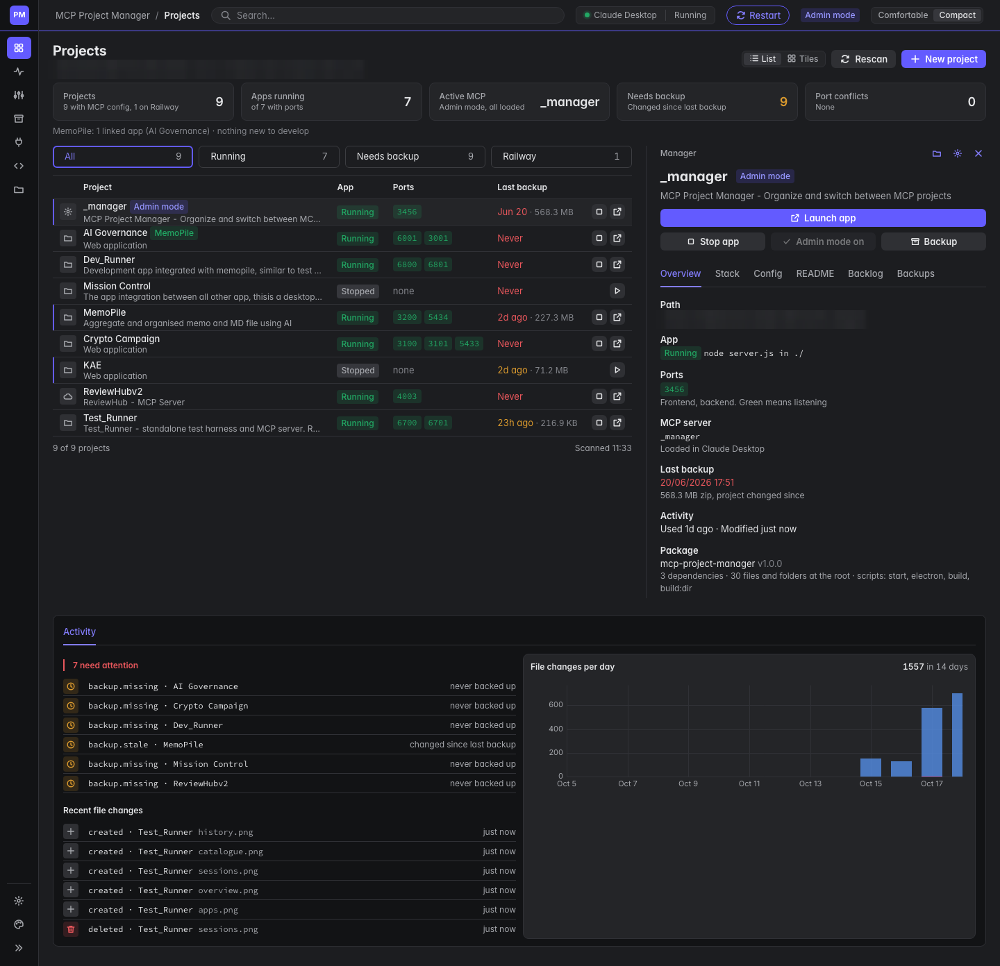
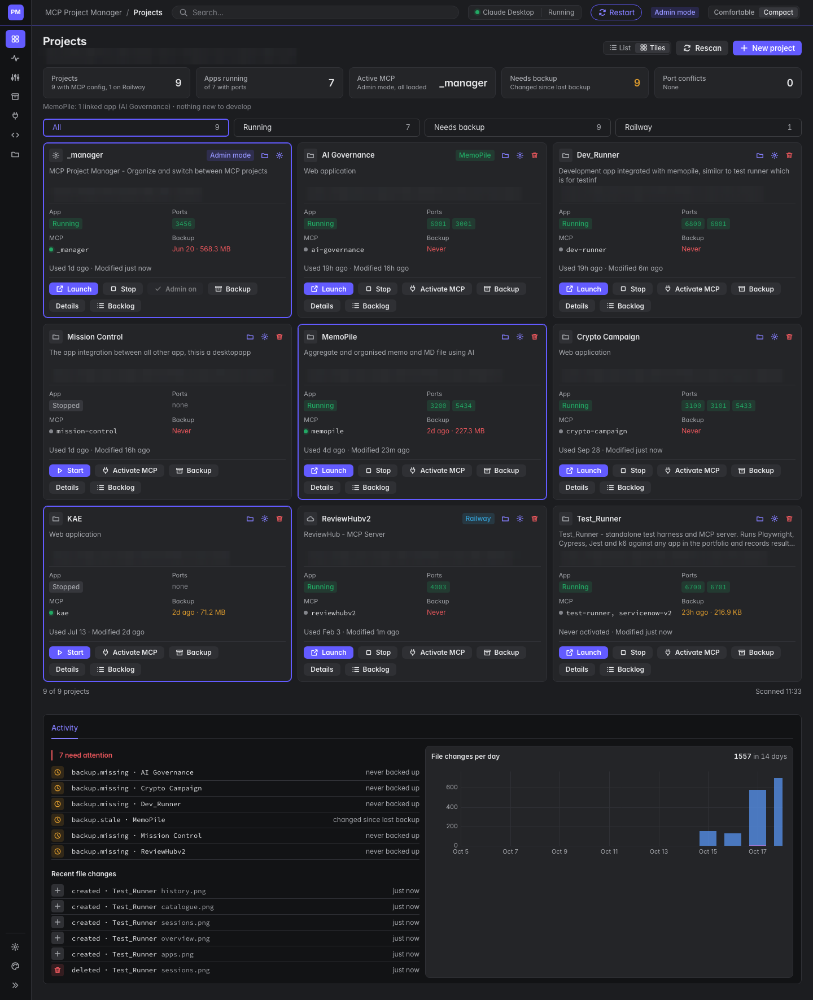
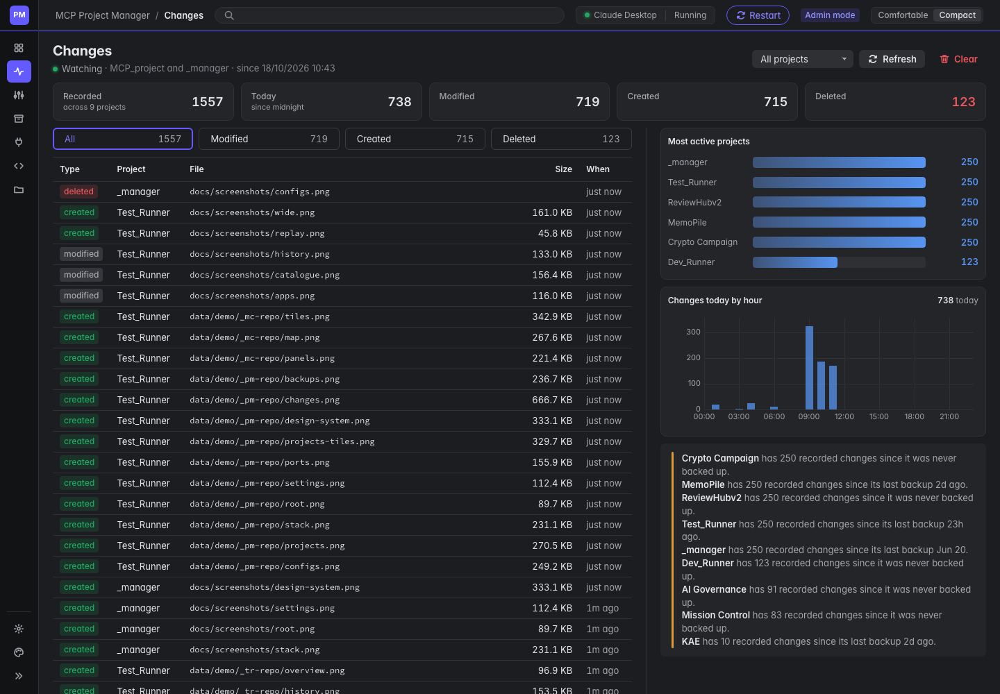
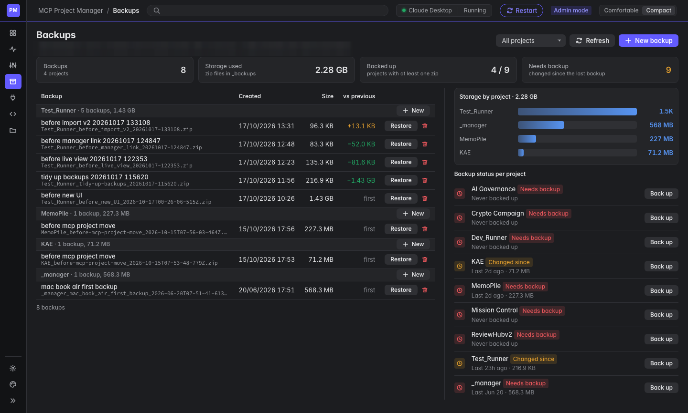
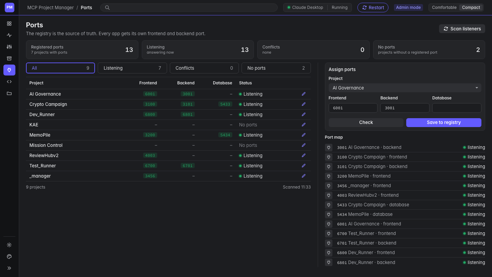
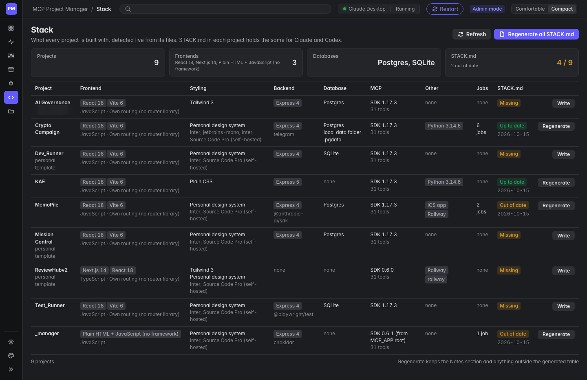
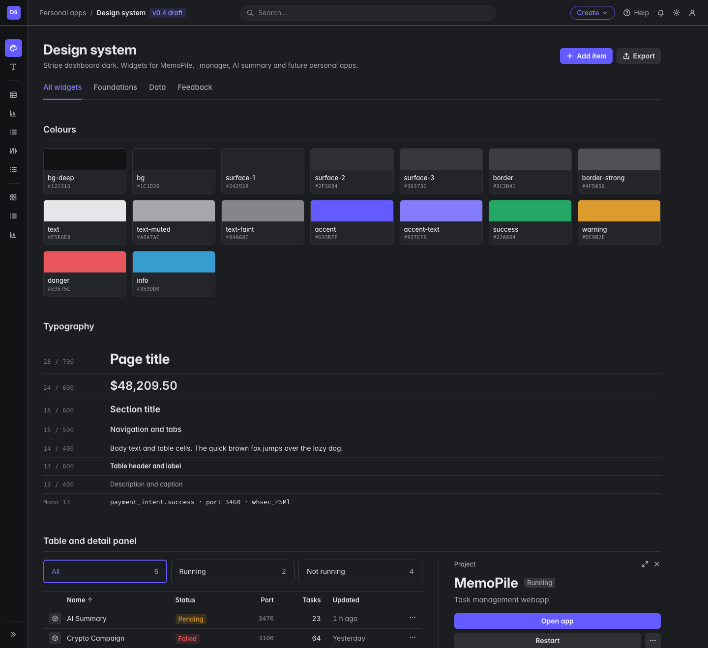

# Project Manager

> Part of a larger agent platform. ▶ [Watch the 90-second overview](https://github.com/man-pi)

The control room for a portfolio of local AI apps and MCP servers. It keeps one MCP server active in Claude Desktop at a time, starts and stops each app, creates new projects from templates, and keeps the port registry, backups and a record of every file change.

> **Source code is private.** This repository shows what Project Manager does and how it is built. The code is available on request.

## Why

With a dozen apps, each with its own MCP server, ports and folder, things collide: two apps want the same port, Claude Desktop loads the wrong tools, a change goes unbacked. Project Manager is the one place that knows every app, and the other tools in the pipeline ask it rather than guessing.

## What it does

- **Activate an MCP.** One project's MCP server goes into Claude Desktop at a time, then Claude Desktop restarts. An admin mode gives Claude access across all projects.
- **Start and stop apps** on their registered ports, from one click.
- **Initialize** an existing app: detects its start command and ports from its config, and moves any port that clashes to a free one.
- **New project** from a template (personal design system, work look, or plain), as a web app or a web app plus an iOS app. It writes the app, its MCP server and the guidance files AI agents follow.
- **Configs** shows which tool permissions each MCP server gives Claude (read, write, delete, shell, system).
- **MemoPile link.** Suggests MemoPile projects flagged "App to develop"; only linked apps are worked on by Dev Runner and Test_Runner.

## Screenshots

Real screens; project names, paths and other details are blurred.

| | |
|---|---|
|  |  |
| **Projects**: app state, ports, MCP server and last backup, with a detail panel and activity | **Projects as tiles**: the same list at a glance |
|  |  |
| **Changes**: every created, modified and deleted file, with the most active projects and changes by hour | **Backups**: zip backups, storage per project and what changed since the last one |
|  |  |
| **Ports**: the port registry, what is listening, and conflicts | **Stack**: what every project is built with, detected live, and a stack file for AI agents |
|  | |
| **Design system**: colours, type, tables, detail panels and charts shared by the apps | |

## How it is built

| Part | Technology |
|---|---|
| Server | Node.js and Express |
| UI | Plain HTML, CSS and JavaScript on a personal design system |
| File watching | chokidar, recording every change per project |
| AI integration | Writes Claude Desktop's MCP configuration; generates CLAUDE.md, AGENTS.md and STACK.md for each project |
| Runs on | A Mac, as a background service that starts at login and restarts itself |

## Part of a pipeline

- [**MemoPile**](https://github.com/man-pi/memopile-showcase): the AI task pile that feeds the pipeline
- [**Dev Runner**](https://github.com/man-pi/dev-runner-showcase): builds tasks with Claude Code and writes their tests
- [**Test_Runner**](https://github.com/man-pi/test-runner-showcase): runs Playwright, Cypress, Jest and k6, and reports back
- [**Mission Control**](https://github.com/man-pi/mission-control-showcase): shows all of them side by side

## Licence

Copyright (c) 2026 man-pi. All rights reserved. The screenshots and text in this repository may not be reused without permission.
